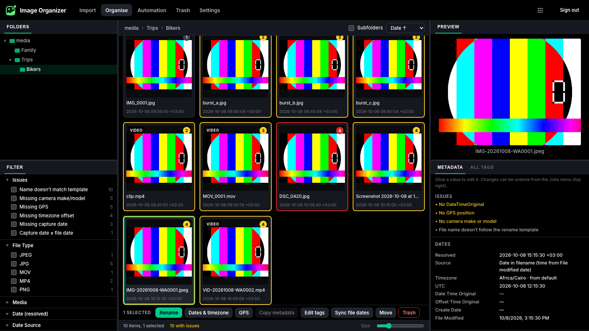
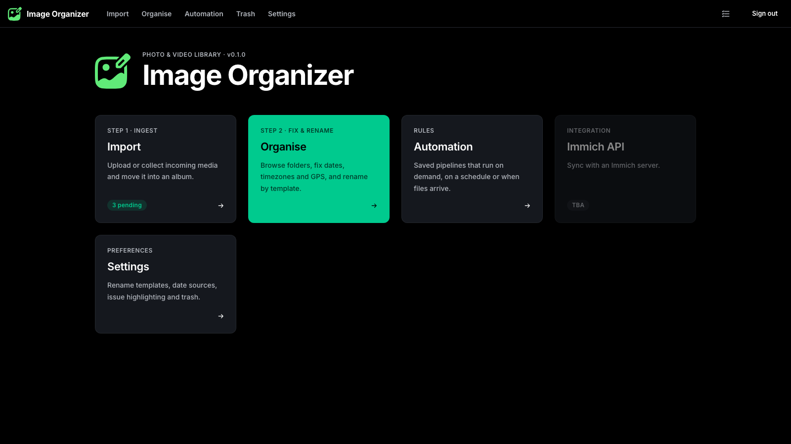
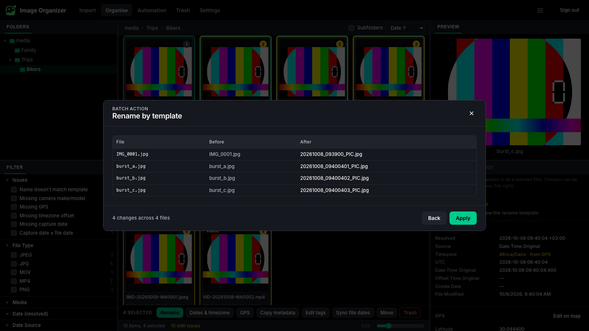
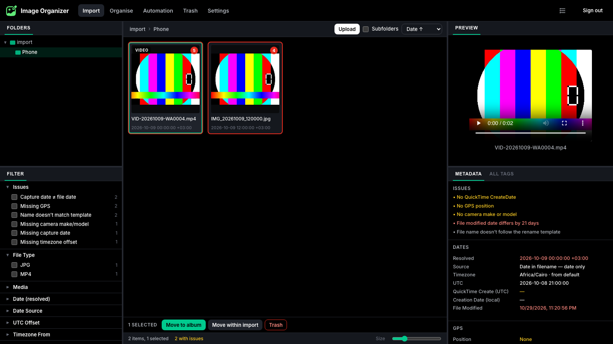
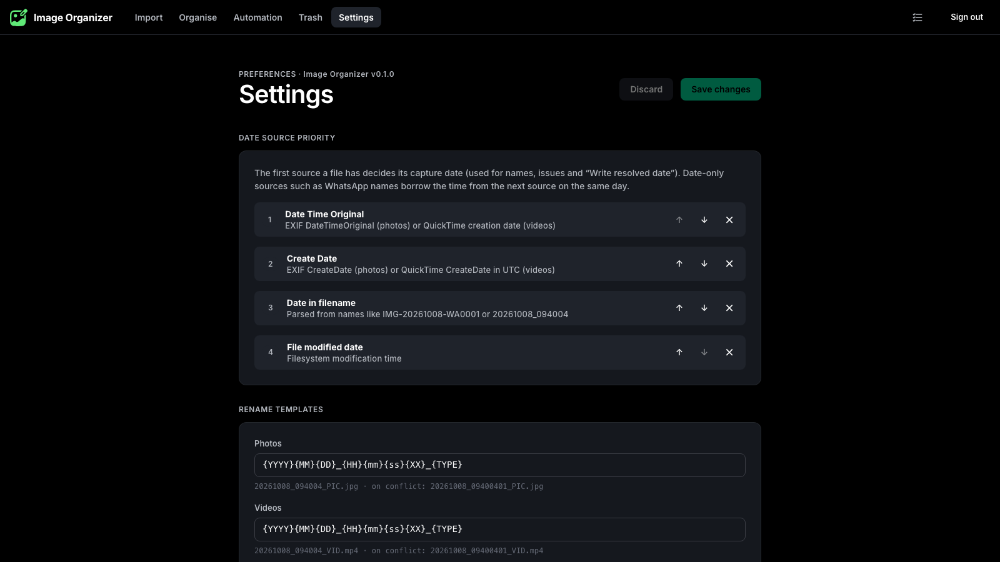

# image-organizer

Self-hosted photo and video organizer with a web UI. It fixes dates, timezones and GPS, copies metadata between files, and renames everything to a consistent template such as `20261008_09400401_PIC.jpg`. It runs as a single Alpine container.

It automates a manual Adobe Bridge workflow: open a folder → check *Date Time Original*, file dates, camera data and GPS → fix what social media stripped → correct the timezone → rename to `YYYYMMDD_HHMMSS[XX]_PIC|VID`.

<p align="center">  </p>

## Features

- **Organize workspace**: Bridge-style layout with resizable panes: folder tree, filter panel, thumbnail grid, preview and metadata panel. Pane sizes are remembered.
- **Rename by template**: separate photo and video templates, editable in the UI (`{YYYY}{MM}{DD}_{HH}{mm}{ss}{XX}_{TYPE}` by default). Files that share a second are **all** numbered (`…09400401`, `…09400402`, …), unique ones get no counter, and extensions are normalized (`.jpeg`/`.JPG` → `.jpg`).
- **Dates and timezones**:
  - **Resolved capture date** from a configurable source priority: Date Time Original → Create Date → date in the filename (WhatsApp, Pixel, screenshots…) → file modified date.
  - **Timezone** from the file's own offset → its GPS position (offline lookup) → your default zone.
  - **Write resolved date** fixes stripped copies.
  - **Shift time**, **set an exact date**, or **set a timezone** (keep the clock time or the instant).
- **GPS**: map picker (OpenStreetMap + place search). It defaults to **your current location** for files without GPS. You can also type coordinates, copy from another file, or remove GPS.
- **Copy metadata**: from one file to many, with checkboxes per group (dates, GPS, camera, lens, exposure, descriptive, keywords, rating) or per tag.
- **Inline editing**: click any value in the Metadata panel to edit it, EXIF or XMP, any writable tag. Like Bridge, edits apply to the whole selection.
- **Issue highlighting** (optional): yellow outline for missing metadata, red for mismatched dates, plus a badge and tooltip listing the issues. Each check can be toggled.
- **Filters**: issues, file type, media kind, month, date source, UTC offset, timezone source, GPS, camera make/model, orientation, ISO, aperture, exposure, focal length.
- **Import**: a separate `/import` mount for incoming media, plus a browser **Upload** button and drag and drop. **Move to album** can also write dates and rename inside the album.
- **Automation**: saved rule pipelines that run on demand, on a **cron schedule**, or **when files arrive** in a watched folder, with a dry run.
- **Safe by design**:
  - every change is shown as a **dry run** before it applies
  - jobs run one at a time, and every job can be **undone** (metadata snapshots, reverse moves)
  - deletes go to a **separate `/trash` mount** with restore and auto-purge
- **Jobs menu**: header button with running, queued and failed counts, progress, errors, Undo and Dismiss.
- **Previews without transcoding**: videos stream the original file with HTTP range requests. HEIC/HEIF previews come from a JPEG rendered on the server.
- **Containerized**: Alpine Linux, amd64 + arm64. Runs as `PUID`/`PGID` so files keep the right owner on your NAS.

<p align="center">
    
  
</p>
<p align="center">
  
  
</p>

## Quick start

1. Generate the admin password hash:

   ```bash
   docker run --rm ghcr.io/zeroomar/image-organizer:latest hash-password 'your-password'
   ```

2. Copy [docker-compose.example.yml](docker-compose.example.yml) to `docker-compose.yml`, which is git-ignored because it holds secrets. Then set the password hash and session secret, and point the volumes at your storage:

   ```yaml
   services:
     image-organizer:
       image: ghcr.io/zeroomar/image-organizer:latest
       restart: unless-stopped
       ports:
         - "8080:80"
       environment:
         TZ: Africa/Cairo
         PUID: 1000
         PGID: 1000
         APP_CONFIG: |
           admin:
             username: admin
             passwordHash: "$$2b$$12$$...."   # every $ escaped as $$ in compose files
           session:
             secret: change-me-to-a-long-random-string
           timezone:
             default: Africa/Cairo
       volumes:
         - ./config:/app            # merged config.yaml, SQLite DB, thumbnail cache
         - /mnt/photos:/media       # the library
         - /mnt/photos-inbox:/import
         - /mnt/photos-trash:/trash
   ```

3. Run `docker compose up -d` and open http://localhost:8080.

The example compose file shows the full homelab setup: an external network, Traefik labels, a bind-mounted config volume and NFS volumes.

## Configuration

### Static config (`APP_CONFIG`)

All static configuration is one multi-line YAML environment variable. At startup it is **deep-merged over `/app/config.yaml`**: `APP_CONFIG` wins on conflicting keys, keys only in the file are kept, and the merged result is written back to `/app/config.yaml`. The config is validated, and startup fails with a readable error that lists each bad key.

```yaml
admin:
  username: admin
  passwordHash: "$2b$12$..."          # bcrypt — generate with `hash-password`
session:
  secret: "at least 16 characters"    # signs the session cookie
  ttlHours: 24
server:                               # optional
  host: 0.0.0.0
  port: 80                            # PORT env var overrides
media:
  root: /media
import:
  root: /import
  maxUploadMB: 2048                   # browser upload limit per file
trash:
  root: /trash
  retentionDays: 30                   # auto-purge; 0 = keep until emptied
timezone:
  default: Africa/Cairo               # IANA zone or a fixed offset like +03:00
map:
  tileUrl: "https://tile.openstreetmap.org/{z}/{x}/{y}.png"
  attribution: "© OpenStreetMap contributors"
  nominatimUrl: "https://nominatim.openstreetmap.org"
```

| Key | Required | Default | Description |
|---|---|---|---|
| `admin.username` | yes | — | The single admin account |
| `admin.passwordHash` | yes | — | bcrypt hash (`$2a$`/`$2b$`) |
| `session.secret` | yes | — | ≥16 chars; signs cookies |
| `session.ttlHours` | no | `24` | Session lifetime |
| `server.port` / `server.host` | no | `80` / `0.0.0.0` | Listen address |
| `media.root` | no | `/media` | Library root |
| `import.root` | no | `/import` | Incoming media root |
| `import.maxUploadMB` | no | `2048` | Per-file upload limit |
| `trash.root` | no | `/trash` | Trash root (its own mount) |
| `trash.retentionDays` | no | `30` | Auto-purge age (Settings can override) |
| `timezone.default` | no | `UTC` | Zone for files with no offset and no GPS |
| `map.*` | no | OSM | Tile server and place search |

### Dynamic settings (UI)

Saved in the SQLite database under `/app` and edited on the **Settings** page:

- date-source priority
- rename templates, `{TYPE}` labels and counter digits/start
- extension map
- issue highlighting (on/off, per check, mismatch tolerance)
- trash retention override

The page also shows the static config read-only, with secrets masked.

### Environment variables

| Variable | Default | Description |
|---|---|---|
| `APP_CONFIG` | — | Static config YAML (above) |
| `PUID` / `PGID` | `1000` | User/group the app runs as (the owner of your media share). Only `/app` is chown'ed. |
| `TZ` | — | Container clock (logs). Photo timezones use `timezone.default`. |
| `APP_DIR` | `/app` | Config/data/cache directory |
| `PORT` | — | Overrides `server.port` |

### Volumes

| Path | Purpose |
|---|---|
| `/app` | `config.yaml` (merged), `data/app.db` (sessions, settings, metadata cache, jobs/undo, trash index, rules), `cache/thumbs/` |
| `/media` | Your library. The Organize page works here. |
| `/import` | Incoming media. Files can be dropped in by other tools or uploaded in the browser. |
| `/trash` | Deleted files, kept as `/trash/<media\|import>/<original path>` for exact restore. Use a separate mount; moves across devices are copy → verify → unlink. |

### Generating the password hash

```bash
docker run --rm ghcr.io/zeroomar/image-organizer:latest hash-password 'your-password'
docker run --rm -it ghcr.io/zeroomar/image-organizer:latest hash-password    # prompts
```

The command prints the hash plus a compose-escaped version (`$` → `$$`).

### Reverse proxy and HTTPS

The container serves **plain HTTP on port 80**; terminate TLS at your reverse proxy (see the Traefik labels in the example compose file). The app trusts `X-Forwarded-*` headers, so the session cookie is marked `Secure` behind HTTPS, and login rate limiting sees real client IPs.

> The GPS dialog's "current location" uses the browser's geolocation API, which only works over **HTTPS** (or `localhost`).

## Using it

### Workflow

1. **Import**: upload files or let them land in `/import`. Select them and choose **Move to album**: pick or create a folder under `/media`, and optionally write resolved dates, rename by template and sync file dates.
2. **Organize**: open the album. Tiles with problems are outlined; filter by **Issues** to work through them:
   - **Dates & timezone** → *Write resolved date* fixes stripped WhatsApp/social copies (date from the filename, time from the same day).
   - **GPS** sets a location; **Copy metadata** pulls dates, GPS or camera info from a good file.
   - Click any value in the Metadata panel to fix a single tag.
3. **Rename**: select all, then **Rename** → preview → Apply.
4. Anything wrong? Open the **Jobs menu** (header) and click **Undo**.

### Rename templates

| Token | Value | | Token | Value |
|---|---|---|---|---|
| `{YYYY}` `{YY}` | Year | | `{XX}` | Conflict counter (empty when unique) |
| `{MM}` `{DD}` | Month, day | | `{TYPE}` | `PIC` / `VID` (configurable) |
| `{HH}` `{mm}` `{ss}` | Time | | `{orig}` | Original name |
| `{SSS}` | Milliseconds | | `{make}` `{model}` | Camera |
| `{tz}` | Offset, e.g. `+0300` | | `{folder}` | Folder name |

Times are the resolved **local** capture time in the file's timezone. When files land on the same name, every one of them is numbered from `01`, ordered by capture time (including sub-seconds), skipping names already taken in the folder. Re-running a rename on a renamed folder changes nothing.

### How dates are resolved

| Source | Photos | Videos |
|---|---|---|
| Date Time Original | EXIF `DateTimeOriginal` (+ `OffsetTimeOriginal`, sub-seconds) | `Keys:CreationDate` (local + offset), else QuickTime `CreateDate` |
| Create Date | EXIF `CreateDate` | QuickTime `CreateDate` (stored in **UTC**) |
| Date in filename | `IMG-20261008-WA0001`, `IMG_20261008_094004`, `PXL_…`, `Screenshot 2026-10-08 at 09.40.04`, `20261008_094004…` | same |
| File modified | mtime | mtime |

The first available source in your priority list wins. Date-only sources (WhatsApp) borrow the time of day from the next source on the same day. Writing dates sets EXIF local time + `OffsetTime*` on photos, and QuickTime UTC + `Keys:CreationDate` on videos.

### Supported formats

| Format | Preview | Metadata write |
|---|---|---|
| JPEG, PNG, WebP | ✅ native | ✅ |
| HEIC / HEIF | ✅ JPEG rendered by the server | ✅ |
| MP4, MOV, M4V | ✅ original streamed (range requests) | ✅ |

## API

All endpoints are under `/api` and require the session cookie from login. Every non-GET request must send `X-Requested-With: image-organizer` (CSRF guard). Full reference: [docs/api.md](docs/api.md).

### Auth
| Method | Path | Description |
|---|---|---|
| POST | `/api/auth/login` | Login (`{username, password}`), sets the cookie. Rate-limited to 10/min. |
| POST | `/api/auth/logout` | Logout |
| GET | `/api/auth/me` | Current user |
| GET | `/api/health` | Health + version (public) |

### Browse
| Method | Path | Description |
|---|---|---|
| GET | `/api/tree?root=&rel=` | Child folders |
| GET | `/api/folder?root=&rel=&recursive=0\|1` | Files with metadata, resolved date and issues |
| GET | `/api/metadata?root=&rel=` | All tags, grouped |
| GET | `/api/thumb?root=&rel=&size=` | JPEG thumbnail |
| GET | `/api/file?root=&rel=` | Original file (Range support) |
| POST | `/api/folders` | Create a folder |

### Jobs
| Method | Path | Description |
|---|---|---|
| POST | `/api/jobs/plan` | Dry run: what would change, file by file |
| POST | `/api/jobs` | Run steps on a selection |
| GET | `/api/jobs` · `/api/jobs/{id}` | Job status |
| POST | `/api/jobs/{id}/undo` | Undo a job |
| GET | `/api/events` | Server-sent job updates |

### Import, trash, settings, rules
| Method | Path | Description |
|---|---|---|
| POST | `/api/import/upload?rel=` | Upload one file (multipart) |
| GET | `/api/import/count` | Pending files |
| GET | `/api/trash` | Trashed items |
| POST | `/api/trash/restore` · `/api/trash/purge` | Restore / delete permanently |
| GET/PUT | `/api/settings` | Dynamic settings |
| GET/POST/PUT/DELETE | `/api/rules[/{id}]` | Automation rules |
| POST | `/api/rules/{id}/run` · `/api/rules/{id}/plan` | Run / dry-run a rule |

### Example: rename a folder via curl

```bash
H='X-Requested-With: image-organizer'
curl -c cookies.txt -H "$H" -H 'Content-Type: application/json' \
  -d '{"username":"admin","password":"your-password"}' http://localhost:8080/api/auth/login

REQ='{"selection":{"folder":{"root":"media","rel":"Trips/Bikers"}},"steps":[{"type":"rename"}]}'

# Dry run
curl -b cookies.txt -H "$H" -H 'Content-Type: application/json' -d "$REQ" http://localhost:8080/api/jobs/plan

# Apply, then poll the job
curl -b cookies.txt -H "$H" -H 'Content-Type: application/json' -d "$REQ" http://localhost:8080/api/jobs
curl -b cookies.txt http://localhost:8080/api/jobs/<job-id>
```

Available steps: `applyDates`, `shiftDates`, `setDate`, `setTimezone`, `rename`, `syncFileDates`, `setGps`, `clearGps`, `copyMetadata`, `editTags`, `move`, `moveByDate`, `trash` (see [docs/automation.md](docs/automation.md)).

## Development

Requirements: Node 22+, ExifTool and ffmpeg (`brew install node@22 exiftool ffmpeg`).

```bash
npm install
scripts/run-local.sh            # dev with hot reload: http://localhost:5173  (admin / admin)
scripts/run-local.sh --prod     # production build: http://127.0.0.1:8080
scripts/run-local.sh --reset    # wipe and re-seed the sandbox from fixtures/
```

`run-local.sh` needs no Docker. Everything lives in `.local-test/` (git- and docker-ignored): the generated `app-config.yaml`, the app dir (DB, cache), and copies of the sample media in `media/`, `import/` and `trash/`.

```bash
npm test             # unit + integration tests (real ExifTool/ffmpeg against fixtures/)
npm run typecheck    # all workspaces
npm run build        # shared → server → web
scripts/make-fixtures.sh   # regenerate the sample media in fixtures/
```

More: [CLAUDE.md](CLAUDE.md) (contributor rules and repo map), [docs/](docs/) (architecture, configuration, metadata and dates, renaming, import, automation, API, UI), `.claude/skills/` (step-by-step recipes for adding endpoints, batch actions, filters, automation steps and UI), [design.md](design.md) (design system).

## Project structure

```
image-organizer/
├── apps/
│   ├── app-icon.svg            # Logo (favicon/PNG icons are generated from it)
│   ├── server/                 # Fastify API (TypeScript)
│   │   ├── src/
│   │   │   ├── main.ts         # Startup: config → services → HTTP, graceful shutdown
│   │   │   ├── config/         # APP_CONFIG merged over /app/config.yaml, zod schema
│   │   │   ├── auth/           # Sessions, bcrypt, CSRF header, login rate limit
│   │   │   ├── fs/             # Root path jail (media/import/trash), cross-device moves
│   │   │   ├── metadata/       # ExifTool wrapper + date/GPS tag builders
│   │   │   ├── index/          # SQLite metadata cache, resolved dates, issues
│   │   │   ├── jobs/           # Planner (dry run) + serial engine with undo
│   │   │   ├── thumbs/         # sharp / ffmpeg / embedded-JPEG thumbnails
│   │   │   ├── trash/          # /trash with restore + retention
│   │   │   ├── automation/     # Rules: cron (croner) + folder watch (chokidar)
│   │   │   └── http/routes/    # browse, jobs, import, admin
│   │   └── test/               # Integration tests (real ExifTool/ffmpeg)
│   └── web/                    # React + Vite UI
│       └── src/
│           ├── theme/          # design.md tokens (Nomad green)
│           ├── api/            # fetch client, react-query hooks, SSE
│           ├── organize/       # Workspace panes, grid, filters, metadata, dialogs
│           ├── components/     # Nav, Jobs menu, dialogs, folder tree/picker
│           └── pages/          # Login, Home, Import, Organize, Automation, Trash, Settings
├── packages/shared/            # Shared TS: dates/TZ, rename engine, issues, schemas
├── docker/                     # entrypoint (PUID/PGID), hash-password
├── fixtures/                   # Sample media for tests and local runs
├── scripts/                    # run-local.sh, make-fixtures.sh
├── docs/                       # Developer documentation
├── Dockerfile
├── docker-compose.example.yml
└── .github/workflows/
    ├── docker-publish.yml      # Multi-platform build → GHCR (on tag)
    └── release.yml             # GitHub Release from the annotated tag
```

## Troubleshooting

**Startup fails with "Invalid configuration"**: the log lists each bad key. A common one is `admin.passwordHash: must be a bcrypt hash`: in compose files every `$` must be written as `$$`.

**Login fails**: check the hash against your password:
```bash
docker run --rm ghcr.io/zeroomar/image-organizer:latest node -e \
  "console.log(require('bcryptjs').compareSync(process.argv[1], process.argv[2]))" 'your-password' '$2b$12$...'
```

**Files end up owned by the wrong user / permission denied**: set `PUID`/`PGID` to the owner of the media share (`ls -ln /mnt/photos`). The container checks at startup that every root is readable and writable.

**"Current location" doesn't work in the GPS dialog**: the browser only allows geolocation over HTTPS (or `localhost`). Use the reverse proxy URL.

**HEIC thumbnails are missing**: the server tries sharp, then ffmpeg, then the JPEG preview embedded in the file. A HEIC without an embedded preview that ffmpeg can't decode shows no thumbnail; its metadata can still be edited.

**A tag edit fails with "Nothing was written"**: that tag is read-only for this file type (e.g. `Composite:*`, `File:*`).

**Changes made outside the app don't show**: the metadata cache is keyed by file size + modified time. A change that keeps both (e.g. `exiftool -P`) is picked up after you restart the app or delete `/app/data/app.db`.

## Releasing

Pushing a semver tag triggers GitHub Actions to (1) build and push a multi-platform image to GHCR and (2) publish a GitHub Release. Use an **annotated** tag; its message becomes the release notes (there is no CHANGELOG.md):

```bash
git tag -a 0.1.0 --cleanup=verbatim -F notes.md   # notes.md = curated release notes
git push origin 0.1.0
# → ghcr.io/zeroomar/image-organizer:0.1.0, :0.1, :latest
# → https://github.com/ZeroOmar/image-organizer/releases/tag/0.1.0
```

The tag also becomes the app version shown on the Home and Settings pages and in `/api/health`. Bump `version` in the `package.json` files to match.

## Limitations

- Single admin account (no users/RBAC)
- One job at a time (sequential queue by design, so batches never race on the same files)
- Folder listings read metadata on first open, which takes a few seconds for very large folders (aimed at libraries under ~10k files)
- No RAW formats yet (JPEG, PNG, WebP, HEIC, MP4, MOV)
- Immich integration is planned (TBA)

## License

[Apache 2.0](LICENSE)
